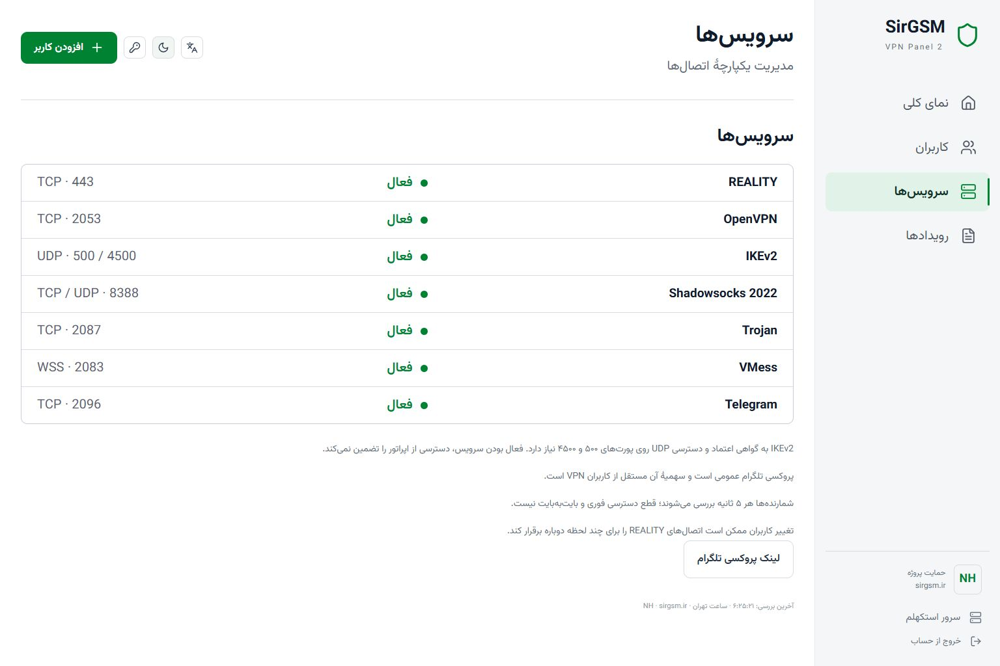

# SirGSM VPN Panel 2

کنار هر کاربر، دکمهٔ **«کانفیگ‌ها و اشتراک»** برای دریافت کانفیگ سرویس‌های مجاز و ساخت لینک خصوصی صفحهٔ کاربر قرار دارد. صفحهٔ فارسی/انگلیسی کاربر، مصرف مشترک، انقضا، QR محلی، لینک سرویس‌ها و دانلود OpenVPN و IKEv2 را نشان می‌دهد. اشتراک استاندارد base64 شامل REALITY، Shadowsocks، Trojan و VMess است؛ OpenVPN و IKEv2 فایل جدا دارند.

لینک خصوصی را صریحاً بسازید و فقط به همان کاربر بدهید. دارندهٔ لینک می‌تواند کانفیگ‌های آن حساب را بگیرد؛ لینک را منتشر نکنید. از همان پنجره می‌توان لینک را تعویض یا باطل کرد. اتمام حجم، انقضا و غیرفعال‌شدن حساب، دریافت اشتراک و فایل را متوقف می‌کند. لینک باطل‌شده پاسخ ۴۰۴ می‌دهد. گزارش مصرف اشتراک، مجموع ارسال و دریافت را در قسمت download نشان می‌دهد. صفحهٔ کاربر دسترسی مدیریتی ندارد.

نصب و ارتقا به‌صورت پیش‌فرض تلاش می‌کنند **BBR** را برای اتصال‌های TCP جدید سرور فعال و پس از ری‌استارت حفظ کنند. اگر کرنل پشتیبانی نکند، حالت خودکار تنظیم فعلی را حفظ و پیام چاپ می‌کند. این تنظیم روی TCP کل سرور اثر دارد و تضمین سرعت یا عبور از فیلترینگ نیست. گزینهٔ `--tcp-congestion keep` تنظیم فعلی و فایل‌های ذخیره‌شده را دست‌نخورده نگه می‌دارد؛ گزینهٔ `--tcp-congestion bbr` در صورت نبود پشتیبانی، نصب را متوقف می‌کند. متغیر محیطی معادل، `SIRGSM_TCP_CONGESTION=auto|bbr|keep` است. اتصال‌های قبلی باید دوباره وصل شوند تا تنظیم تازه روی آن‌ها اعمال شود.

دکمهٔ «تغییر اطلاعات مدیر» در بالای پنل برای تغییر نام کاربری و رمز با واردکردن رمز فعلی است؛ پس از تغییر، همهٔ نشست‌ها خارج می‌شوند. فایل ورود اولیه فقط سابقهٔ نصب است و رمزهای بعدی را نشان نمی‌دهد.

نصب اولیهٔ تعاملی، دامنهٔ اختیاری می‌پرسد؛ برای نصب غیرتعاملی از `--domain vpn.example.com` یا متغیر `SIRGSM_DOMAIN` استفاده کنید. رکورد A باید مستقیم به IP سرور اشاره کند، پروکسی DNS خاموش باشد و رکورد A/AAAA نامرتبط حذف شود. پنل با گواهی دامنه و تمدید خودکار در `https://vpn.example.com:8443` در دسترس خواهد بود؛ ورود با IP و گواهی IP سرویس‌های VPN حفظ می‌شود. دامنه در ارتقا حفظ می‌شود و IP را پنهان نمی‌کند.

گزینهٔ `--openvpn-transport udp` انتقال UDP را انتخاب می‌کند؛ مقدار `tcp` هم پشتیبانی می‌شود. پیش‌فرض نصب تازه TCP است و ارتقا انتخاب قبلی را حفظ می‌کند. پیش از UDP، پورت UDP 2053 را در فایروال ابری و سرور باز کنید. روی نصب موجود، دستور زیر تنها شنوندهٔ OpenVPN را به UDP تغییر می‌دهد؛ برای برگشت، `udp` را با `tcp` عوض کنید. سپس فایل‌های جدید را دانلود و دوباره وارد برنامه کنید. گواهی کاربر، حجم، انقضا و تک‌اتصالی‌بودن هر گواهی حفظ می‌شود. سرعت و عبور UDP باید روی اپراتور واقعی آزمایش شود.

```bash
sudo /opt/sirgsm-runtime/bin/python /opt/separ/deploy/change_openvpn_transport.py udp
```

[English](README.md) · ساخته‌شده توسط **NH** · با حمایت [sirgsm.ir](https://sirgsm.ir)

پنل مستقل مدیریت VPN برای یک سرور اوبونتو؛ با رابط فارسی و انگلیسی، حالت روشن
و تیره، مدیریت کاربران، دریافت کانفیگ، حجم مشترک و تاریخ انقضا.



## سرویس‌ها

| سرویس | پورت پیش‌فرض | سهمیه |
| --- | --- | --- |
| VLESS + REALITY + Vision | TCP 443 | مشترک هر کاربر |
| OpenVPN با گواهی اختصاصی | TCP 2053 | مشترک هر کاربر |
| IKEv2 با EAP-MSCHAPv2 | UDP 500 / 4500 | مشترک هر کاربر |
| Shadowsocks 2022 | TCP/UDP 8388 | مشترک هر کاربر |
| Trojan با TLS معتبر | TCP 2087 | مشترک هر کاربر |
| VMess با WSS و TLS معتبر | TCP 2083 | مشترک هر کاربر |
| پروکسی تلگرام MTProto / Fake TLS | TCP 2096 | عمومی و مستقل |
| پنل HTTPS | TCP 8443 | ورود با نام کاربری و رمز |
| اعتبارسنجی گواهی IP | TCP 80 | فقط پاسخ ACME |

مجموع آپلود و دانلود شش سرویس VPN هر کاربر در یک سهمیه محاسبه می‌شود. اتمام حجم
یا انقضا، دسترسی سرویس‌های آن حساب را قطع می‌کند. بررسی حدوداً هر ۵ ثانیه انجام
می‌شود؛ بنابراین سقف حجم دقیق و بایت‌به‌بایت نیست. خاموشی ناگهانی سرویس یا سرور
ممکن است بخشی از شمارنده‌های ذخیره‌نشده را از بین ببرد. این نسخه سامانهٔ حسابداری
مالی دقیق نیست. مصرف پروکسی عمومی تلگرام نیز از ترافیک ابری سرور کم می‌شود.

REALITY انتخاب اصلی است. پروتکل‌های دیگر برای سازگاری و آزمایش ارائه شده‌اند؛
نسخهٔ پین‌شدهٔ Xray برای VMess، Shadowsocks، Trojan و WebSocket هشدار منسوخ‌شدن
می‌دهد. کارکرد روی تمام اپراتورها یا عبور از همهٔ روش‌های فیلترینگ تضمین نمی‌شود.

## نصب یک‌خطی فارسی

سرور تازه با **Ubuntu 24.04 LTS**، معماری amd64 یا arm64، IPv4 عمومی و دسترسی
root/sudo لازم است. برای مرحلهٔ نصب و ساخت رابط، حداقل ۱ گیگ رم و ۲ گیگ فضای خالی
پیشنهاد می‌شود. ابتدا پورت TCP 80 و پورت‌های موردنیاز جدول را در فایروال ابری باز
کنید. نصب‌کننده را پیش از اجرا با دسترسی root بررسی کنید.

```bash
sudo bash -c 'set -e; f=$(mktemp); curl -fsSL https://raw.githubusercontent.com/navidhaghpanah/sirgsm-vpn-panel-2/v0.1.5/install.sh -o "$f"; bash "$f" --lang fa; rm -f -- "$f"'
```

نصب‌کننده ابتدا کامل دانلود می‌شود و سپس اجرا می‌شود. فایل موقت را root می‌سازد.
نصب خودکار، تنظیمات VPNهای نامرتبط را بازنویسی نمی‌کند. IP عمومی تشخیص داده می‌شود،
رابط ساخته می‌شود، checksum آرشیوهای Xray و MTG بررسی می‌شود و گواهی واقعی
Let's Encrypt برای **خود IP** صادر می‌شود؛ خرید دامنه لازم نیست.

گواهی IP حدود شش روز اعتبار دارد. تایمر سیستم روزی دو بار نیاز به تمدید را بررسی
و گواهی تازه را برای Nginx و Xray نصب می‌کند. CRL مربوط به OpenVPN و گواهی جداگانهٔ
IKEv2 نیز بررسی هفتگی دارند. پورت ۸۰ باید برای تمدید در دسترس بماند.

اطلاعات ورود اولیه را روی خود سرور بخوانید:

```bash
sudo cat /root/sirgsm-admin.txt
```

وارد `https://YOUR_PUBLIC_IP:8443` شوید. از آیکون کلید می‌توانید نام کاربری و رمز
مدیر را عوض کنید؛ تمام نشست‌های قبلی با تغییر رمز بسته می‌شوند. رمز عمومی ثابت
وجود ندارد. برای تعیین دستی IP، گزینهٔ `--server-ip PUBLIC_IPV4` را به نصب‌کننده
بدهید. نصب‌کننده فایروال AWS/Lightsail را مدیریت نمی‌کند و فقط اگر UFW از قبل فعال
باشد، پورت‌های مستند را به آن اضافه می‌کند؛ قوانین SSH و فایروال را پاک نمی‌کند.

## کاربران و فایل اتصال

برای هر نفر حساب جدا بسازید. حجم بر حسب GB ده‌دهی است: یک گیگابایت برابر یک
میلیارد بایت. تاریخ واردشده در پنل، پایان همان روز به وقت تهران منقضی می‌شود.
فایل‌های اتصال را از بخش کانفیگ همان کاربر بگیرید.

- **OpenVPN:** فایل `SirGSM-<user>-openvpn.ovpn` را در OpenVPN Connect وارد کنید.
  گواهی و کلید اختصاصی داخل فایل است؛ هنگام اتصال نام کاربری و رمز جدا نمی‌خواهد.
  نام پروفایل SirGSM است. هر گواهی فقط یک اتصال هم‌زمان دارد و اتصال دوم، اولی را
  جایگزین می‌کند. فایل همچنان قابل کپی است و به سخت‌افزار یک گوشی قفل نمی‌شود.
- **IKEv2:** پروفایل آیفون یا راهنما و گواهی CA را دریافت کنید. بسته به دستگاه،
  اعتماد به گواهی VPN را نصب و بررسی کنید. اعتبارسنجی گواهی سرور را غیرفعال نکنید.
  CA خصوصی ده سال اعتبار دارد؛ تعویض آن نیازمند نصب اعتماد/پروفایل جدید است.
- **REALITY، Shadowsocks، Trojan و VMess:** لینک را در کلاینت سازگار وارد کنید.
  گواهی IP در Trojan و VMess بررسی می‌شود؛ گزینهٔ ناامن `allowInsecure` ساخته
  نمی‌شود. Shadowsocks به کلاینت پشتیبان SS2022 نیاز دارد.
- **تلگرام:** در صفحهٔ سرویس‌ها، «لینک پروکسی تلگرام» را بزنید. لینک دامنه‌ای و
  IP مستقیم موجود است. دامنه و Fake TLS، IP را از اپراتور یا کاربر پنهان نمی‌کنند.
  این پروکسی عمومی است و سهمیهٔ مشترک کاربران VPN روی آن اعمال نمی‌شود.

تغییر دسترسی کاربران ممکن است اتصال‌های تمام کاربران Xray را برای چند لحظه دوباره
برقرار کند؛ نسخهٔ فعلی برای اعمال مجموعهٔ کاربران، هسته را راه‌اندازی مجدد می‌کند.
در انتقال حساب‌های موجود، اطلاعات اتصال حفظ و شمارش مصرف از زمان انتقال آغاز می‌شود.

## نگهداری و به‌روزرسانی

برای به‌روزرسانی، نصب‌کنندهٔ نسخهٔ بررسی‌شده را با `--upgrade` اجرا کنید. پیش از
جایگزینی فایل‌ها، نسخهٔ پشتیبان root-only در `/var/backups/sirgsm` ساخته می‌شود.
نسخهٔ امن دیگری را خارج از سرور نگه دارید؛ این آرشیوها حاوی رمز و کلید خصوصی‌اند.
بازگشت خودکار و تراکنشی در تمام خطاهای نصب تضمین نشده؛ دسترسی SSH و مسیر پشتیبان
را نگه دارید. تغییر IP به صدور گواهی تازه و دریافت دوبارهٔ کانفیگ‌ها نیاز دارد.

```bash
sudo journalctl -u separ-worker -u separ-web --since '10 minutes ago'
sudo systemctl list-timers 'sirgsm-*'
```

نام‌های داخلی سرویس شامل `separ-web`، `separ-worker`، `xray`،
`openvpn-server@amazon`، `strongswan` و `sirgsm-mtg` است. شناسه‌های قدیمی separ و
amazon برای سازگاری نصب اولیه حفظ شده‌اند؛ نام محصول و پروفایل‌های کاربر SirGSM است.

داده‌ها و رمزهای واقعی بیرون از مخزن هستند: `/var/lib/separ`،
`/var/lib/separ-exports`، `/etc/separ`، `/etc/openvpn`، `/etc/swanctl`،
`/etc/sirgsm-mtg`، `/etc/letsencrypt` و `/root/sirgsm-admin.txt`.
این مسیرها و فایل‌های کانفیگ کاربران را در GitHub منتشر نکنید.

## آزمایش و امنیت

تست‌های واحد، کنترل ورود و CSRF، اعتبارسنجی ورودی، سهمیهٔ مشترک، انقضا، دریافت
کامل فایل، نشست‌ها و محافظت فایل حسابداری را پوشش می‌دهند. تست‌های اجرایی زیر
روی **سرور آزمایشی نصب‌شده** حساب موقت و فضای شبکهٔ جدا می‌سازند؛ ممکن است برای
چند لحظه اتصال کاربران Xray دوباره برقرار شود:

```bash
sudo /opt/sirgsm-runtime/bin/python /opt/separ/deploy/e2e.py
sudo /opt/sirgsm-runtime/bin/python /opt/separ/deploy/e2e_ike.py
```

اولی چهار پروتکل Xray، OpenVPN، سهمیه، انقضا و جلوگیری از دسترسی به شبکهٔ داخلی
را بررسی می‌کند. دومی اتصال رمز‌شدهٔ IKEv2، گواهی، EAP، شمارش حجم و قطع نشست فعال
را آزمایش می‌کند. اسکریپت `deploy/probe_ike.py SERVER_IP` فقط دسترسی خارجی UDP را
می‌سنجد؛ جای تست اتصال واقعی روی اپراتور را نمی‌گیرد.

تست اجرایی روی Ubuntu 24.04 amd64 انجام شده است. نصب تازه و کلاینت‌های بومی
آیفون، اندروید و ویندوز را در محیط خود بررسی کنید؛ arm64 در نگاشت نصب‌کننده
پشتیبانی می‌شود ولی تست اجرایی نشده است. [سیاست و محدودیت‌های امنیتی](SECURITY.md)
را بخوانید. هیچ بررسی‌ای تضمین «امنیت صددرصد» نیست.

کد پنل تحت مجوز [MIT](LICENSE) است. مجوز اجزای اصلی مطابق مخازن بالادستی خودشان
است. این نصب از OpenVPN Community استفاده می‌کند و لایسنس تجاری Access Server
نمی‌خواهد.
