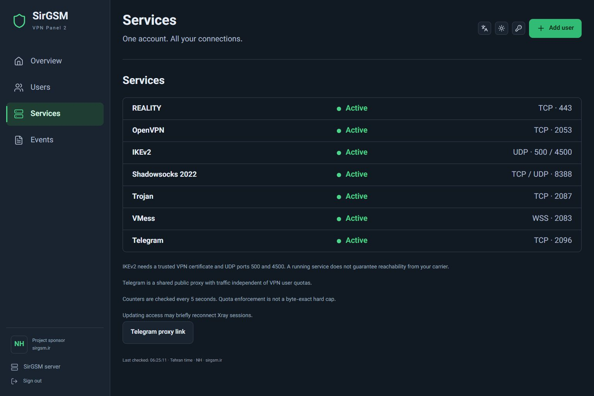

# SirGSM VPN Panel 2

[فارسی](README.fa.md) · Built by **NH** · Sponsored by [sirgsm.ir](https://sirgsm.ir)

[](https://github.com/navidhaghpanah/sirgsm-vpn-panel-2/actions/workflows/ci.yml)

A self-hosted, bilingual administration panel for one Ubuntu VPN server. Manage
per-user credentials, shared traffic quotas and expiry dates from a responsive
English/Persian interface with light and dark themes.



## Services

| Service | Default port | User accounting |
| --- | --- | --- |
| VLESS + REALITY + Vision | TCP 443 | Shared quota |
| OpenVPN, certificate authentication | TCP 2053 | Shared quota |
| IKEv2, EAP-MSCHAPv2 | UDP 500 / 4500 | Shared quota |
| Shadowsocks 2022, AES-256-GCM | TCP/UDP 8388 | Shared quota |
| Trojan + verified TLS | TCP 2087 | Shared quota |
| VMess + WebSocket + verified TLS | TCP 2083 | Shared quota |
| Telegram MTProto / Fake TLS | TCP 2096 | Public/shared; independent |
| HTTPS admin panel | TCP 8443 | Username/password login |
| ACME certificate validation | TCP 80 | Challenge responses only |

The five-second meter adds upload and download across a user's enabled VPN
services. Reaching the shared quota or expiry revokes credentials and ends
sessions. This is an approximate cap: traffic can exceed a limit between polls,
and abrupt daemon/server failure can lose unflushed observations. It is not a
byte-exact billing system. Telegram traffic still consumes your cloud bandwidth.

REALITY is the recommended default. The additional legacy transports are provided
for compatibility and testing; the pinned Xray release warns that VMess,
Shadowsocks, Trojan and WebSocket are deprecated. Installation does not guarantee
reachability through every carrier, censorship system or cloud firewall.

## Install

Use a **fresh Ubuntu 24.04 LTS** server (amd64 or arm64), a public IPv4 address,
root/sudo access and inbound access to the ports above. At least 1 GB RAM and
2 GB free disk space are recommended for installation/building. Allow TCP 80 in
the cloud firewall before starting: public IP certificate issuance needs it.
Review the installer before executing software as root.

One-line English installer:

```bash
sudo bash -c 'set -e; f=$(mktemp); curl -fsSL https://raw.githubusercontent.com/navidhaghpanah/sirgsm-vpn-panel-2/v0.1.0/install.sh -o "$f"; bash "$f" --lang en; rm -f -- "$f"'
```

The download finishes successfully before execution; the temporary file is
created by root. The installer refuses unrelated existing VPN installations.
It detects the public IP, builds the frontend, verifies upstream Xray/MTG archive
checksums, installs services and requests a real Let's Encrypt **IP certificate**.
No purchased domain is needed. IP certificates last about six days; a systemd
timer checks renewal twice daily and deploys the new certificate to Nginx/Xray.
OpenVPN CRLs and the separate IKEv2 server certificate have weekly renewal checks.

Read initial credentials locally on the server:

```bash
sudo cat /root/sirgsm-admin.txt
```

Open `https://YOUR_PUBLIC_IP:8443`, sign in, then use the key icon to change the
administrator username/password. There is no universal default password. Password
changes invalidate all sessions. The installer accepts `--server-ip PUBLIC_IPV4`
if automatic detection is unsuitable. It does not manage AWS security groups or
Lightsail firewall rules. It only adds documented host firewall rules when UFW
is already enabled; it does not reset your firewall or SSH configuration.

## Users and connection files

Create one account per person. Select allowed services, shared GB allowance
(decimal GB: 1 GB = 1,000,000,000 bytes) and an optional expiry date. Dates entered
in the UI expire at the end of that day in Tehran time. Download each user's
connection files through the authenticated panel.

- **OpenVPN:** import `SirGSM-<user>-openvpn.ovpn` into OpenVPN Connect. The embedded
  unique certificate/private key authenticates the client; no separate username
  or password prompt is needed. The profile is named SirGSM. Only one simultaneous
  OpenVPN session per certificate is allowed; a second connection replaces the
  first. This does **not** make the file uncopyable or bind it to physical hardware.
- **IKEv2:** download the iPhone configuration profile or the instructions and VPN
  CA certificate for other platforms. Review/install the VPN CA trust as required
  by your device. Never disable server certificate validation. The private VPN CA
  has a ten-year lifetime; rotating it requires reissuing client trust/profiles.
- **Xray protocols:** import the generated links into a compatible client. Trojan
  and VMess validate the server's public IP certificate; no `allowInsecure` flags
  are generated. Shadowsocks requires a client with SS2022 support.
- **Telegram:** Services → Telegram proxy link. Domain and direct-IP links are
  available. The free DNS alias and Fake TLS do **not** hide the server IP from
  clients or network operators. This proxy is independent of per-user VPN quotas.

Account updates can briefly reconnect **all Xray** sessions because the current
reconciler restarts the core when the access set changes. Existing imported
accounts keep their credentials; metering starts when the panel takes ownership.

## Operations and upgrades

Service names are `separ-web`, `separ-worker`, `xray`, `openvpn-server@amazon`,
`strongswan` and `sirgsm-mtg`. The `separ` and `amazon` identifiers are retained
internally for compatibility with the original deployment; public product and
connection-profile branding is SirGSM.

```bash
sudo journalctl -u separ-worker -u separ-web --since '10 minutes ago'
sudo systemctl list-timers 'sirgsm-*'
```

Upgrade from a reviewed release by downloading its installer and passing
`--upgrade`. A root-only snapshot is created under `/var/backups/sirgsm` before
replacement. Keep an off-server copy in a secure location; backups contain keys
and credentials. Configuring another public IP requires a new IP certificate and
freshly downloaded client profiles. The installer does not promise transactional
rollback if provisioning fails: retain SSH access and the backup path printed by
the installer. Do not uninstall Ubuntu or delete SSH keys to reset this panel.

Runtime secrets live outside the repository: `/var/lib/separ`,
`/var/lib/separ-exports`, `/etc/separ`, `/etc/openvpn`, `/etc/swanctl`,
`/etc/sirgsm-mtg`, `/etc/letsencrypt` and `/root/sirgsm-admin.txt`.
Never commit or publish those directories or exported connection files.

## Development and verification

```bash
python -m venv .venv
.venv/bin/pip install -r requirements.txt httpx==0.28.1
.venv/bin/python -m unittest discover -s tests -v
cd frontend && npm ci && npm run build && npm audit --audit-level=high
```

The backend binds to loopback and the privileged worker is separate from the web
process. See [SECURITY.md](SECURITY.md) for boundaries and limitations. Functional
checks on an **installed test server** create a temporary user and isolated
network namespace; they may briefly reconnect Xray users. Run them deliberately:

```bash
sudo /opt/sirgsm-runtime/bin/python /opt/separ/deploy/e2e.py
sudo /opt/sirgsm-runtime/bin/python /opt/separ/deploy/e2e_ike.py
```

The first exercises four Xray transports, OpenVPN, shared metering, quota/expiry
revocation and private-network isolation. The second exercises an isolated IKEv2
client, EAP/certificate authentication, encrypted Internet egress, byte metering
and active-session revocation. `deploy/probe_ike.py SERVER_IP` only tests external
UDP responder reachability; it is not an authentication or carrier VPN test.
Native iOS/Android/Windows clients and fresh-server installation must be checked
for your deployment. Current runtime testing has been on Ubuntu 24.04 amd64;
arm64 is supported by the installer asset mapping but has not been runtime-tested.

## License and upstreams

Panel source: [MIT](LICENSE). VPN components retain their respective upstream
licenses and are downloaded, not relicensed by this project:
[Xray](https://github.com/XTLS/Xray-core), [OpenVPN](https://github.com/OpenVPN/openvpn),
[strongSwan](https://github.com/strongswan/strongswan), [mtg](https://github.com/9seconds/mtg),
[Certbot](https://github.com/certbot/certbot). No commercial OpenVPN Access Server
license is required for the community OpenVPN service used here.
